# 路线图、工程规范与风险

> **执行计划：** 产品级 V1 分 **两个阶段** 交付。第一阶段详见 [06-phase1-development-plan.md](06-phase1-development-plan.md)。

---

## 1. 两阶段交付总览

**全量产品级 V1 = 第一阶段（Android）+ 第二阶段（iOS + 双端上架）。**

```mermaid
flowchart LR
  subgraph phase1 [Phase1_AndroidProduct_14to16w]
    P1S0[Sprint0_Skeleton]
    P1S1[Sprint1_Domain]
    P1S2[Sprint2_Jobs]
    P1S3[Sprint3_Image]
    P1S4[Sprint4_Audio]
    P1S5[Sprint5_VideoHW]
    P1S6[Sprint6_ProductUI]
    P1S7[Sprint7_QualityGate]
  end
  subgraph phase2 [Phase2_iOS_and_Store_10to12w]
    P2S0[iOS_Skeleton_UniFFI]
    P2S1[iOS_Media_Parity]
    P2S2[Dual_Platform_Hardening]
    P2S3[Store_Submission_IAP]
  end
  P1S0 --> P1S1 --> P1S2 --> P1S3 --> P1S4 --> P1S5 --> P1S6 --> P1S7
  P1S7 --> P2S0 --> P2S1 --> P2S2 --> P2S3
```

### 1.1 第一阶段：Android 产品级（约 14–16 周）

**完成定义：** Android 上视频/照片/音频三种媒体可真实使用；共享 Rust Core API 冻结；可内测，**不可上架 iOS**。

| Sprint | 原里程碑 | 周期 | 交付 |
|--------|----------|------|------|
| Sprint 0 | M0 | 1.5 周 | Monorepo + UniFFI + Compose 空壳 + 版本号 |
| Sprint 1 | — | 1.5 周 | `ss-domain` 决策引擎 + 快照测试 |
| Sprint 2 | — | 1.5 周 | `ss-jobs` + SQLite 持久化 + Observer |
| Sprint 3 | M1 | 2.5 周 | 照片闭环：50 张批量、滑杆对比、另存相册 |
| Sprint 4 | M2 | 1.5 周 | 音频闭环：WAV/FLAC→AAC/Opus |
| Sprint 5 | M3（Android） | 4 周 | 视频 HW：Media3 + H.264/HEVC + 前台服务 |
| Sprint 6 | M4（Android） | 2.5 周 | 雷达、保险箱、预设 UI、中英、设置 |
| Sprint 7 | M5（Android 部分） | 1 周 | 失败注入、真机冒烟、包体积、API 冻结签收 |

**第一阶段验收：** [01-product-design.md](01-product-design.md) §17 V1 冻结清单 **Android 列全绿**。

### 1.2 第二阶段：iOS 对等 + 双端上架（约 10–12 周）

**完成定义：** iOS 与 Android 行为对等；双端加固；Play / App Store 可提交。

| Sprint | 原里程碑 | 周期 | 交付 |
|--------|----------|------|------|
| Sprint 0 | M0（iOS） | 2 周 | XCFramework + SwiftUI 空壳 + PhotoKit 权限 |
| Sprint 1 | M1–M3（iOS） | 5–6 周 | 三种媒体 iOS 对等（AVAssetWriter、Rust 图/音） |
| Sprint 2 | M4–M5 | 3 周 | 热/电降级、OEM 黑名单、遥测、包体积 |
| Sprint 3 | M5 | 2 周 | 商店材料、权限审核、Play Billing / StoreKit 骨架 |

**第二阶段验收：** V1 冻结清单 **双端全绿** + 内测/审核通过。

### 1.3 原里程碑对照表

| 原里程碑 | 第一阶段 | 第二阶段 |
|----------|----------|----------|
| M0 骨架 | Sprint 0（Android + Rust） | Phase 2 Sprint 0（iOS） |
| M1 图片闭环 | Sprint 3 | Phase 2 Sprint 1 |
| M2 音频闭环 | Sprint 4 | Phase 2 Sprint 1 |
| M3 视频 HW | Sprint 5（仅 Android） | Phase 2 Sprint 1（iOS AVAssetWriter） |
| M4 产品化 | Sprint 6（雷达/保险箱/UI） | Phase 2 Sprint 1–2（iOS 对等） |
| M5 加固上架 | Sprint 7（Android 质量门） | Phase 2 Sprint 2–3（双端上架） |

---

## 2. 第一阶段默认拍板（已冻结）

以下原「开放问题」在第一阶段已拍板，实现与评审以本表为准：

| # | 决策项 | 第一阶段取值 | 第二阶段 |
|---|--------|--------------|----------|
| 1 | 最低系统版本 | **Android minSdk 26** | iOS **16+** |
| 2 | AVIF 输出 | **不做** | P1 backlog 评估 |
| 3 | MP3 输出 | **不做** | P1 backlog 评估 |
| 4 | 免费批量上限 / IAP | **无付费墙、无 IAP** | StoreKit / Play Billing 骨架 |
| 5 | 应用名称 | **SpaceSlimmer（空间瘦身）** | 不变 |
| 6 | 替换保险箱 | **强制，不可关闭** | 不变 |
| 7 | iOS 可发布包 | **不做**（仅 `ios/README.md` 骨架） | 完整 SwiftUI App |

**Feature flag（全程默认关）：** `avif`、`ffmpeg`、`av1sw`、`mp3`、`iap`。

---

## 3. 团队分工建议

| 角色 | 第一阶段 | 第二阶段 |
|------|----------|----------|
| Rust 核心 | domain、jobs、image、audio、UniFFI | API 冻结维护、iOS 绑定 |
| Android | Compose、Media3、MediaStore、Service | 加固、上架、Billing |
| iOS | 仅 README 占位 | SwiftUI、AVFoundation、PhotoKit |
| 实验室 | 样片、Android 机型冒烟 | 双端主观评分矩阵 |
| 产品设计 | 预设文案、对比体验、权限转化 | 商店截图、审核文案 |

一人团队顺序：**Sprint 0→1→2→3→4→5→6→7**，不要跳过图片闭环直接做视频。

---

## 4. 工程规范

- `ss-domain` 零 `unsafe`、零文件系统；纯函数 + 快照测试。
- 禁止在 UI 层复制一份码率公式。
- 新增预设必须改 `preset_table_version` 并补测试。
- 平台回调不得在主线程做重 I/O。
- 所有输出先 tmp 再 commit。
- 提交信息不写密钥；vault 不进备份。
- Feature flag：`avif`、`ffmpeg`、`av1sw`、`mp3`、`iap` 默认关。

代码评审检查单：

1. 失败是否可能删原片？
2. 是否在主线程转码？
3. 是否假设编码器支持 CRF？
4. 是否在 Rust 里拉 4K RGB 帧？
5. 预估是否同步打了一次真实编码？

---

## 5. 风险登记

| 风险 | 影响 | 缓解 | 阶段 |
|------|------|------|------|
| 安卓 OEM 硬件编码器质量差 | 花屏、体积不降、绿边 | 探测 + 失败回退 H.264 + 机型黑名单 | P1 Sprint 5；P2 黑名单 |
| iPhone HEVC 已很瘦 | “压缩没用”差评 | 均衡默认 1080p 封顶；诚实跳过 | P2 |
| iOS 后台被杀 | 任务失败 | 产品话术 + 前台保活；队列可恢复 | P2 |
| UniFFI 异步锁 | 死锁、ANR | observer 异步出锁；文档约束 | P1 Sprint 2 |
| App 体积（AVIF/FFmpeg） | 下载转化 | 模块化、App Bundle/按需 | P1 不做 AVIF/FFmpeg |
| HEVC 专利 | 法务 | 只用系统编码器；地区策略问律师 | 全程 |
| 用户替换后骂画质 | 口碑 | 默认另存、保险箱、对比预览 | P1 Sprint 6 |
| 4K 内存 | OOM | 平台直通；图片采样 | P1 Sprint 3/5 |
| 扫描全相册隐私审核 | 拒审 | 阶梯权限；Picker 主路径 | P1 Sprint 6 |
| Media3 码率不够细 | 达不到目标体积 | 自研 MediaCodec 管线 Plan B | P1 Sprint 5 |
| 多视频并发更慢 | 发热降频 | 默认 1 路；最快 2 路需探测 | P1；P2 热/电降级 |
| Windows 无 iOS 编译环境 | P2 延迟 | P1 只交付 Android | 已接受 |

---

## 6. 关键技术决策记录（ADR 摘要）

**ADR-1 视频主路径用平台 HW，不用 Rust FFmpeg。**  
速度、电量、包体积、专利。Rust 做决策与编排。

**ADR-2 图片主路径用 Rust。**  
双端一致、易并行、不依赖相册导出质量。

**ADR-3 体积控制用目标码率模型，不用移动端两遍 CRF。**  
HW 限制；用区间预估管理预期。

**ADR-4 替换必经保险箱。**  
安全与信任是品类入场券。第一阶段**不可关闭**。

**ADR-5 不共享 UI。**  
Compose 与 SwiftUI 各自跟系统走，共享 domain。

**ADR-6 V1 跳过 HDR 电影模式与高帧慢动作。**  
正确性优先于覆盖率。

**ADR-7 产品级 V1 分两阶段交付。**  
第一阶段 Android 产品级 + Rust API 冻结；第二阶段 iOS 对等 + 上架。避免双端同时开战。

---

## 7. 上架后 backlog

### P1（上架后迭代）

- AV1 HW、AVIF、目标体积二次编码、Live Photo、MKV、设备预估校准、自定义参数、无限批量会员（IAP）。

### P2（长期）

- 软件视频回退、FFmpeg exotic、GIF 动画、小组件、桌面同源核心。

---

## 8. 立即下一步（Phase 1 签收 → Phase 2）

**Phase 1（Android 产品级）剩余：**

1. `packaging/validate-signoff-readiness.ps1` — 主机自动化门。
2. `packaging/run-device-smoke.ps1` + `docs/smoke-checklist.md` — 真机烟测。
3. `packaging/memory-profiling-guide.md` — 50 JPEG 内存峰值记入 `docs/07-phase1-signoff.md`。
4. `packaging/record-device-signoff.ps1` — 填 07 签字栏 → **已签收**。

**Phase 2（iOS + 双端上架）开工前：** 以 07 签收为门禁；详见 [06-phase1-development-plan.md](06-phase1-development-plan.md) §1.2 与 `ios/README.md`。

文档变更流程：先改 `docs/`，再改代码；预设数字只改 `03` 与 `ss-domain` 一处实现。
