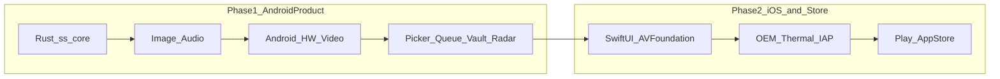
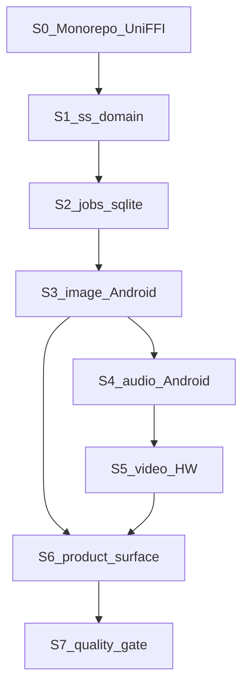

# SpaceSlimmer 第一阶段开发计划

> **状态：** 内测候选（2026-09-11）— **不要再用单一 88%。** 分层口径与 [07 签收报告](07-phase1-signoff.md) §1 对齐：Phase 1 工程闭环 ~93%；Android V1（01 §17）代码 ~92%；全量 V1（Android+iOS+上架）~48%；含 P1/P2 ~64%。真机 smoke 见 `smoke-checklist.md`，**未签收**（代码债已清，待真机签字）。
> **关联文档：** [01 产品](01-product-design.md) · [02 架构](02-technical-architecture.md) · [03 管线](03-media-pipeline.md) · [04 API](04-api-and-data-models.md) · [05 路线图](05-roadmap.md)

对照 [01-product-design.md](01-product-design.md) 的 V1 冻结清单与 [05-roadmap.md](05-roadmap.md) 的两阶段映射，把「产品级完成」收成 **两个阶段**。第一阶段不以 demo 收尾，而以 **Android 上三种媒体可真实使用的产品** 收尾，并把 UniFFI 契约冻住，避免第二阶段重写核心。

当前开发环境以 Windows 为主，第一阶段以 **Android 为唯一可交付面**；iOS 只落契约与目录骨架，完整 SwiftUI / PhotoKit / VideoToolbox 放到第二阶段。

---

## 1. 两阶段总览

**全量产品级 V1 = 第一阶段 + 第二阶段。**



### 1.1 第一阶段完成定义（Android 产品级，不是原型）

| 维度 | 交付内容 |
|------|----------|
| 共享 Rust | `ss-domain` / `ss-jobs` / `ss-image` / `ss-audio` / `ss-sqlite` / `ss-core` UniFFI 按 [04-api-and-data-models.md](04-api-and-data-models.md) 落地，**API 冻结** |
| 媒体能力 | 视频 HW（H.264/HEVC）；照片 Rust；音频 WAV/FLAC→AAC（平台）或 Opus |
| 用户流程 | Picker 多选 → 预设 → 预估区间 → 一键批量 → 任务中心 → 结果对比 → 另存/保险箱替换 |
| 产品表面 | 空间雷达、保险箱、中英、设置、前台服务、智能跳过 |
| 安全 | 失败/取消不碰原片；替换必经保险箱；默认另存 |

**第一阶段明确不包含：** iOS 可发布包、IAP、AVIF、MP3 输出、MKV/FFmpeg、HDR/慢动作**转码**、自定义 CRF、云与广告。

**已落地但非 Phase 1 最小集（见 [08-wave-backlog.md](08-wave-backlog.md)）：** AV1 HW 编码、Opus（`opus-encode` feature）、Live/Motion **静图**探测与标记、EMA/片段/小组件等 Wave E/F 项——签收以 [01-product-design.md](01-product-design.md) §17 冻结表为准，不阻塞 Android 内测。

### 1.2 第二阶段完成定义（双端产品级 V1 可上架）

| 维度 | 交付内容 |
|------|----------|
| iOS 对等 | Picker、三种媒体、队列、保险箱、雷达、对比、中英 |
| 加固 | 热/电降级、OEM HEVC 黑名单、编码失败遥测、包体积优化 |
| 上架 | Play / App Store 材料、权限审核、Play Billing / StoreKit 骨架 |
| 后续 | P1 backlog（AVIF、Live Photo、指定体积校准等）上架后排 |

### 1.3 第一阶段默认拍板（已冻结）

| 决策项 | 第一阶段取值 |
|--------|--------------|
| 最低系统版本 | Android minSdk **26**（iOS 16 在第二阶段启用） |
| 应用名称 | **SpaceSlimmer（空间瘦身）** |
| 付费 | **无 IAP、无付费墙** |
| 照片 AVIF | **不做** |
| 音频 MP3 输出 | **不做** |
| 替换保险箱 | **强制**，不可关闭 |
| iOS | 仅目录骨架 + 接入说明，**无可发布包** |

---

## 2. 仓库落地结构

按 [02-technical-architecture.md](02-technical-architecture.md) 建 Monorepo，**不建可编译的完整 iOS App**：

```
SpaceSlimmer/
  docs/
  rust/
    Cargo.toml                 # workspace
    crates/
      ss-core/                 # uniffi 入口
      ss-domain/
      ss-probe/
      ss-image/
      ss-audio/
      ss-jobs/
      ss-platform/
      ss-sqlite/
    tests/                     # 黄金样张、决策快照
  android/
    app/                       # Compose 应用
    core-android/              # UniFFI 绑定、Gateway
    video-hw/                  # Media3 / MediaCodec
    audio-hw/
  ios/
    README.md                  # XCFramework 接入说明（第二阶段）
  packaging/
    uniffi-bindgen 脚本
    cargo-ndk 构建
  testdata/                    # 自产小样片（版权自有）
```

---

## 3. 工作流与依赖顺序



**硬约束：**

1. 先图片闭环 → 音频 → 视频（视频仅 Android）。
2. 禁止在 Compose 里复制码率公式；所有决策在 `ss-domain`。
3. 所有输出先写 `tmp/`，校验通过再 Commit。
4. UniFFI Observer 回调不得同步重入 `CoreEngine` 锁。

**建议工期：**

| 团队规模 | 第一阶段总工期 |
|----------|----------------|
| 1 人全职 | 14–16 周 |
| 2 人（Rust+算法 / Android UI+Media3） | 9–11 周 |

---

## 4. Sprint 明细

### Sprint 0 — 工程骨架（约 1.5 周）

**目标：** 真机/模拟器打开 App，Kotlin 能调用 `CoreEngine.version()` 与 `preset_table_version()`。

**任务清单：**

- [x] 初始化 `rust/` Cargo workspace；配置 `clippy` / `fmt`；GitHub Actions 跑 `cargo test`
- [x] UniFFI proc-macro 导出最小 `CoreEngine`（`version`、`preset_table_version`、`open`）
- [x] Gradle + `cargo-ndk` 编译 `arm64-v8a`（Debug 可加 `x86_64` 模拟器）
- [x] Compose 空壳：首页占位、关于页显示版本号
- [x] Android 沙箱创建 `data_dir` / `tmp_dir` / `vault_dir`
- [x] Backup 规则排除 `tmp/`、`vault/`
- [x] NDK r28+（Android 15 16KB page size 兼容）

**验收标准：**

- `assembleDebug` 成功
- 安装后关于页显示 `0.1.0` / `preset_v1.0`
- CI 绿色通过 Rust 空测

**产出物：** 可编译 Monorepo、双端版本号可见（iOS 仅 README 占位）

---

### Sprint 1 — 决策引擎冻结（约 1.5 周）

**目标：** [03-media-pipeline.md](03-media-pipeline.md) 纯函数全部进 `ss-domain`，零 I/O、零 `unsafe`。

**任务清单：**

- [x] 实现 `QualityPreset` → 分辨率封顶、质量系数 q、音频码率、图片 JPEG q
- [x] 视频目标码率：`src × q × codec_coeff × sqrt(pixel_ratio)`，夹地板，≤ 源码率 95%
- [x] 指定体积反推（达不到时返回 `Decision.skip` + 原因）
- [x] 跳过规则：视频 &lt; 8% 且 &lt; 5MB；照片/音频对应阈值；HDR/慢动作/会压更大
- [x] `decide` / `decide_batch` → `Decision`（含 `estimate_bytes_low/high`、`TimeClass`）
- [x] 快照测试：均衡 / 小体积 / HEVC 源跳过 / 4K→1080p

**验收标准：**

- `cargo test -p ss-domain` 全绿
- 改预设数字必须同步 `preset_table_version`（本阶段锁 `preset_v1.0`）
- 无文件系统、无 `unsafe`

**产出物：** 可独立测试的决策引擎 crate

---

### Sprint 2 — 任务系统（约 1.5 周）

**目标：** 核心能排队、持久化、取消、崩溃恢复；UI 可用假 Job 联调。

**任务清单：**

- [x] `ss-jobs`：`JobGroup` / `Job` 状态机（Queued/Running/Paused/Cancelling/Succeeded/Skipped/Failed）
- [x] 并行配额：视频 1、图片 4（受内存）、音频 4
- [x] Observer 事件 100–200ms 节流
- [x] `ss-sqlite` 建表：`groups` / `jobs` / `vault` / `settings`
- [x] `CoreObserver` 桥到 Kotlin `callbackFlow`（接口已导出，UI 联调待 Sprint 3+）
- [x] 提交协议：只写 `tmp/{job_id}`；取消删不完整输出

**验收标准：**

- 杀进程后 Queued 任务仍在
- Running 任务恢复为 Queued，`tmp/` 已清理
- 暂停/取消/重试 API 可用

**产出物：** 可持久化任务队列 + SQLite schema v4（`skip_reason` / `fail_reason` / `decision_json` / `message` / vault `compressed_uri`）

---

### Sprint 3 — 照片产品闭环（约 2.5 周）

**目标：** 50 张相册照片一键压缩——第一个「能给真人用」的切片。

**Rust `ss-image`：**

- [x] JPEG→JPEG（`image` crate 高质量编码；mozjpeg NDK 待后续接入）
- [x] PNG 无 alpha→JPEG；有 alpha→WebP/PNG
- [x] WebP 输出（有损 `webp` crate；quality≥95 仍走无损）；**不做 AVIF**
- [x] EXIF 方向校正（GPS 写入待完善，设置项已预留）
- [x] 大图 max side 下采样

**Android：**

- [x] Photo Picker 多选（无全盘权限可用）
- [x] 平台 probe → `MediaFingerprint`
- [x] 预设页：最高 / 高清 / 小体积 + JPEG/WebP
- [x] 任务列表、结果页节省数字、**前后滑杆对比**
- [x] 另存 `MediaStore.Images`（`IS_PENDING` → 发布）

**验收标准：**

- 50 张中旗舰机 &lt; 30s 量级
- 失败项原图仍在；输出更大则 Skip
- 平均 JPEG 体积可见下降

**产出物：** 可独立发布的「照片压缩」切片（内测）

---

### Sprint 4 — 音频产品闭环（约 1.5 周）

**任务清单：**

- [x] `ss-audio`：symphonia 解 WAV/FLAC/MP3/M4A（探测/校验）
- [x] Opus 编码（Rust `opus-encode` feature；Gradle/`build-android-core.ps1` 默认启用；缺 feature 时 UI 隐藏 Opus）
- [x] AAC 经平台 `AacEncoder`（MediaCodec `audio/mp4a-latm`）
- [x] 语音档 mono 64kbps；音乐高 192 / 小 96（`ss-domain` 预设）
- [x] 源已低码率有损则 skip；WAV/FLAC 不 skip
- [x] SAF / 文件选择器选录音目录
- [x] **不做 MP3 输出**

**验收标准：**

- 10 分钟 WAV → 约 5%–15% 体积，系统播放器可播
- 128kbps AAC 源被跳过并显示 `skip.already_efficient`

**产出物：** 音频压缩闭环

---

### Sprint 5 — Android 视频硬件闭环（约 4 周，主风险）

**目标：** Rust 出 `Recipe`，Kotlin `VideoTranscoder` 执行。

**任务清单：**

- [x] Media3 Transformer 主路径
- [~] **Plan B MediaCodec + MediaMuxer**（Wave C：Media3 主路径；失败时 `MediaCodecPlanB` Extractor+Codec+Muxer + HEVC OEM 黑名单；仍保留 75% 码率 Media3 重试）
- [x] `MediaCodecList` 探测 HEVC 真硬件；失败回退 H.264
- [x] 输出 MP4；音频 AAC copy 或转码；旋转走 metadata
- [x] HDR / 120fps+ 慢动作 → Skip（`skip.hdr` / `skip.slowmo`）
- [x] 进度回调 `on_platform_progress`；取消 API 已导出
- [x] 校验：输出体积检查（`complete_with_output_check`）
- [x] 前台服务 + 通知渠道「压缩任务」
- [x] 磁盘满：停后续、已完成保留 — `ss-jobs::disk_full_halt_stops_dispatch_until_resume`；`disk_full_halt` + `pause_all_active_groups`

**验收标准：**

- 1080p30 H.264 约 1 分钟：均衡档可播，体积 35%–55% 量级
- 4K 样片：均衡封顶 1080p，体积明显下降
- 取消/杀进程/会压更大：原片 100% 在

**产出物：** Android 视频 HW 转码闭环

---

### Sprint 6 — 产品表面（约 2.5 周）

**目标：** 三个闭环收成一个 App，完成 V1 冻结清单 Android 列。

**任务清单：**

- [x] 信息架构：底部导航 → 首页 → 选择 → 预设 → 任务中心 → 结果 → 保险箱 → 设置
- [x] **空间雷达：** MediaStore 扫描大文件 + `decide` 预估（权限可用时）— **已完成**（混合队列单次 `submit_group`，每项 `request_override`）
- [x] **保险箱：** `list_vault_items` / `vault_usage` UI；替换写入 + 恢复已联调
- [x] 雷达「预计可省」= `decide` 区间求和
- [x] 设置：默认预设、跳过开关、并行 省电/自动/最快（SQLite 持久化）
- [x] 中英 strings；错误 key 对齐 [04-api-and-data-models.md](04-api-and-data-models.md)
- [x] 默认另存；隐私文案（本地处理、不上传）

**验收标准：**

- [01-product-design.md](01-product-design.md) §17 V1 冻结清单 **Android 列全绿**
- iOS 列标 N/A（第二阶段）

**产出物：** Android 内测候选包（Internal Testing）

---

### Sprint 7 — 质量门（约 1 周）

**任务清单：**

- [x] 失败注入（自动化）：磁盘满停队列、崩溃清 tmp、跳过设置、图片取消 — `docs/failure-injection.md`；损坏文件/HEVC 回退仍须真机
- [ ] 内存：50 张照片峰值有上限，不 OOM（待真机 profiling）
- [x] 包体积：无 FFmpeg，`packaging/run-quality-gate.ps1` 含 `.so` &lt; 15MB
- [ ] 真机冒烟：至少 1 台 1080p + 相册写入（模拟器不作视频验收）
- [x] 文档同步：[07-phase1-signoff.md](07-phase1-signoff.md)

**第一阶段出口检查单：**

- [x] 三种媒体批量 + 预估 + 跳过 + 另存
- [x] 前台服务进度、暂停取消 API
- [x] 雷达可用（有限权限时降级 Picker）
- [x] 任何失败原片仍在（tmp 协议）
- [x] UniFFI 契约冻结，第二阶段 iOS 只加 Gateway

**产出物：** 第一阶段签收报告 + 冻结的 `ss-core` API 版本

---

## 5. 明确不做（防范围膨胀）

| 类别 | Phase 1 不做 | 已落地 backlog（不阻塞 Android 签收） |
|------|--------------|--------------------------------------|
| 平台 | iOS 可发布包 | — |
| 商业化 | IAP、付费墙、广告、水印 | — |
| 格式 | AVIF、FFmpeg、MKV、**MP3 输出** | AV1 HW；Opus（feature 门控） |
| 媒体 | GIF **动画**、HDR **转码**、慢动作 **转码**、Live **视频轨重封装** | Live/Motion **静图**探测 + UI 标记 |
| 技术 | Rust 软件转 4K、视频默认 3 路以上并行、UI 层码率公式 | 自定义参数 / 片段 / 小组件等 Wave E/F |

---

## 6. 风险与缓冲

| 风险 | 影响 | 缓解 | 缓冲 |
|------|------|------|------|
| OEM 编码器质量差 | 花屏、体积不降 | H.264 回退 + MediaCodec Plan B | Sprint 5 预留 1 周 |
| mozjpeg NDK 编译失败 | 照片阻塞 | 回退 `image` crate | Sprint 3 不阻塞 |
| 雷达权限审核 | 转化低 | Picker 始终可用 | 产品文案阶梯授权 |
| 保险箱占空间 | 用户误解没省 | UI 双显示相册已瘦 + vault 占用 | Sprint 6 必做 |
| Windows 无 iOS 编译 | 第二阶段延迟 | Phase 1 只交付 Android | 已接受 |

---

## 7. 与旧里程碑映射

| 原里程碑 | 第一阶段 Sprint | 第二阶段 |
|----------|-----------------|----------|
| M0 骨架 | Sprint 0 | iOS 空壳在 Phase 2 Sprint 0 |
| M1 图片 | Sprint 3 | iOS 照片在 Phase 2 |
| M2 音频 | Sprint 4 | iOS 音频在 Phase 2 |
| M3 视频 HW | Sprint 5（仅 Android） | iOS AVAssetWriter |
| M4 产品化 | Sprint 6 | iOS 产品面对等 |
| M5 加固上架 | Sprint 7（Android 质量门） | 双端上架 + IAP |

---

## 8. 立即下一步（内测候选 → 签收）

工程 Sprint 0–7 已闭环；剩余为**真机验收**，不是新功能开发：

1. **主机门：** `packaging/validate-signoff-readiness.ps1`（`cargo test` + release `.so` 体积 + 07 文档检查）。
2. **设备烟测：** `packaging/run-device-smoke.ps1` → 勾选 `docs/smoke-checklist.md`。
3. **内存：** `packaging/memory-profiling-guide.md`（50 JPEG 峰值）→ 填入 `docs/07-phase1-signoff.md` §4。
4. **失败注入：** `docs/failure-injection.md` § Manual（OEM HEVC / 磁盘满 / 权限）→ 07 签字栏。
5. **签收：** `packaging/record-device-signoff.ps1` 填表后，将 07 状态改为 **已签收**。

iOS / Play 正式提审属第二阶段；**不改** `preset_v1.0` 数字除非走 03 变更流程。

文档变更流程：先改 `docs/`，再改代码；预设数字只改 `03` 与 `ss-domain` 一处实现。
