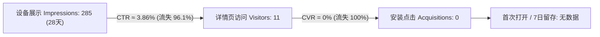

# SpaceSlimmer Google Play 商店转化率全面诊断与系统优化方案

> **目标应用**：`SpaceSlimmer: Media Compressor` (`com.spaceslimmer.app`) · 正式版 `6 (0.2.2)` · 发布于 2026-11-04 · 覆盖 178 个国家/地区 · 免费应用\
> **数据采集来源**：BrowserOS neo 实时抓取 Google Play Console（`grow-overview`、`store-listings`、`store-settings`、`tracks/production`、`vitals/app-size`、`app-content`、`paid-app`）、美区公开商店页与头部竞品搜索页 + 本地完整源码（`android/`、`rust/`、`scripts/`、`store/`、`release/store_assets/`）深度核验。

***

## 一、核心目标与背景（Goal Description）

当前 `SpaceSlimmer` 在 Google Play 上已具备完整的产品技术壁垒（Rust 共享核心 + 硬件加速音视频照片三合一压缩 + 原片保险箱可反悔机制 + WinDirStat 风格 Treemap 存储分析 + 18.7 MB 超轻量包体），但**过去 28 天获得 285 次设备展示，仅带来 11 位商品详情访问者（CTR ≈ 3.86%），最终安装点击 0 次（详情页转化率 CVR = 0%）**。

本方案的目标是通过\*\*「止血排雷 → 视觉与元数据重构 → 多语言放量 → 端内口碑与实验迭代」\*\*四阶段系统工程，将转化漏斗拆解到每一个环节并逐一击穿：

1. **搜索/浏览展示 → 详情页点击率（CTR）**：从当前 `3.86%` 提升至 `12%–18%+`；
2. **详情页访问 → 安装点击转化率（CVR）**：从 `0%` 提升至工具类健康基准 `25%–38%+`；
3. **曝光规模与算法权重**：消除 Play Console 曝光降权警告（DEX 0% 混淆），补齐 5 个商店标签与 10+ 国本地化，打通自然搜索增量；
4. **合规与账号安全零风险**：彻底对齐代码实际行为、Data Safety 声明与 Google Play 政策，杜绝账号级连带风险。

***

## 二、现状深度诊断：为什么 285 次展示 = 0 次安装？

### 2.1 全链路漏斗实时数据（截至 2026-11-19）




| 维度                  | 当前实测状态                                           | 行业健康基准（Tools 工具类）        | 诊断结论                                                |
| :------------------ | :----------------------------------------------- | :----------------------- | :-------------------------------------------------- |
| **设备展示次数（28天）**     | `285`（11/4 发版后冲高至 \~28/天，随后回落至 \~10/天）           | 爬坡期 `2,000–10,000+`      | 缺核心高搜词（标题无 `Video`/`Photo`）+ 仅 1 种语言 + 0 标签，自然曝光池极窄 |
| **展示 → 访问点击率（CTR）** | `11 / 285 = 3.86%`                               | `10%–20%`                | **第一道大坝决堤**：图标语义反向、标题无痛点词、0 评分、中文开发者名导致 96% 用户划走    |
| **访问 → 安装转化率（CVR）** | `0 / 11 = 0%`                                    | `25%–38%`                | **第二道大坝决堤**：欧美英文用户点进来看到前两张是中文乱码假图 + 混杂裸截图，直接秒退      |
| **应用下载大小**          | **`18.7 MB`**（同行中位值 `41.6 MB`，轻 `22.9 MB`！）      | 同行中位值 `41.6 MB`          | **极强隐藏优势被完全浪费**，商店文案与截图未宣传“超轻量”卖点                   |
| **商店本地化语言**         | 仅 **`en-IN`（英语 - 印度）1 种**                        | 至少覆盖 `en-US` + 10–15 大语种 | App 内已有 10 国语言，商店却只建了 1 个 `en-IN`，白白放弃全球非英文搜索词      |
| **商店标签（Tags）**      | **`0` 个**（仅显示系统建议“工具”）                           | 填满 **`5` 个**精准标签         | 缺失同行群组与“类似应用”推荐引擎的关键输入                              |
| **商品详情实验（A/B）**     | `0` 运行 / `0` 已结束                                 | 持续迭代图标/首图/短描             | 尚无任何科学验证闭环                                          |
| **技术与政策健康度**        | **2 项警告**：DEX 混淆 `0%`（<25% 影响曝光）；欧盟 DSA 交易者声明待处理 | `0` 警告，R8 混淆 ≥50%        | **代码层存在直接降权与合规风险**                                  |

***

### 2.2 线上公开商店页（美区 `hl=en&gl=US`）逐项“劝退点”实证


对比实时抓取的美区商店页与本地资源文件，定位出 **8 大核心致命问题**：

#### 致命问题 1（P0）：全球默认详情的首屏视觉几乎全毁（纯中文 + 伪造线框 + `□` 乱码豆腐块 + 中英混杂）

* **前 2 张手机截图（搜索与详情页最黄金的 C 位）**：线上排在第 1、2 位的是 [screenshot\_1.png]() 和 [screenshot\_2.png]()，由 [generate\_store\_assets.py]() 生成：
  * **100% 简体中文**（`"空间雷达 · 快速定位臃肿媒体"`、`"本地硬件编码 · 隐私保险箱"`）展示给全球 178 国英文用户！
  * **字体缺失导致每行列表全是乱码方框 `□`**（`□ 智能扫描相册与大体积视频`、`□ 硬件加速视频编码`），极其廉价粗糙！
  * **非真实 App UI 的暗色假线框图**，与第 3–7 张浅色真实截屏画风彻底割裂。
* **置顶大图（1024×500）**：[feature\_graphic\_1024x500.png]() 同样是 **100% 简体中文 + 4 行密集小字**，在搜索结果卡片或横幅推荐位上完全不可读。
* **第 3–7 张真实截屏（[screenshot\_01.jpg]() – [screenshot\_05.jpg]()）问题汇总**：
  * **零营销包装**：无大标题卖点文案、无手机边框、保留了杂乱的国内运营商状态栏（`09:36`、`0.00 KB/S`、`HD1`、`4G`、`5G`、`67` 电量）。
  * **UI Bug 直接暴露给潜在用户**：`screenshot_05.jpg` 中 `Balanced` 被截断为 **`Balan...`**，顶部挂着刺眼红字 `"2 vault backups expire within 3 days"`，底部主按钮是禁用灰色；`screenshot_04.jpg` 英文界面里直接混出大量中文（`内部存储 (用户数据分区)`、`剩余可用空间`、`系统与私有数据`、`我的音频`、`我的书籍`）；`screenshot_02.jpg` 出现中文文件名 **`宝宝咳嗽.mp3`** 与微信导出名 `mmexport1790078878439.mp4`；`screenshot_01.jpg` 为纯中文保险箱且露出**私人儿童照片**与两条重复文件名。
  * **视觉冲击力太弱**：`screenshot_03.jpg` 展示的压缩案例仅 `39.2 MB → 16.4 MB`（仅省 `22.8 MB`），远不如 `1.2 GB → 280 MB (-76%)` 有瞬间点击冲动。

#### 致命问题 2（P0）：App 图标存在「代码坐标写反」Bug——箭头向外指（语义变成“放大/展开”！）

* 在 [generate\_icons.py]() 中，代码注释明明写着 `# Inward compression arrows`（向内压缩箭头），但四个多边形箭头顶点写反了，导致渲染出的图标是**四个箭头全部指向外侧（`← ↑ → ↓` 扩张/全屏图标）**！
* 同时背景使用暗淡深蓝灰 `#2B4C7E` + 预裁圆角透明底（Google Play 明确要求提交 **512×512 全满幅正方形无透明圆角**，由系统统一裁切蒙版），且图标内完全看不出「视频/照片/存储」品类特征。

#### 致命问题 3（P0）：竞品搜索货架对比惨烈——标题遗漏最高流量主词


实测美区搜索 `video compressor` 前 15 名竞品，规律极其清晰：

* **关键词覆盖**：前 15 名中 **14 个应用**在 30 字符标题中直接放入 `Video` + `Compress/Compressor`（如 `Compress Video Size Compressor`、`Panda Video Compress & Convert`、`Video Compressor - Reduce Size`）。而 `SpaceSlimmer: Media Compressor` **连 `Video` 和 `Photo` 这两个最高搜索量词都没有**！普通用户很少搜索 `"Media Compressor"`。
* **图标视觉**：头部竞品图标几乎全部采用**高饱和亮色（亮橙/翡翠绿/亮蓝）+ 清晰的“视频/播放键被向内挤压”隐喻**。
* **信任信号**：头部竞品普遍 `4.5★–4.9★`、`5M+–10M+` 下载，或如第 2 名 `Compressor (JoshAtticus, 4.9★)` 直接在首图用大字打出 **`Fast. No ads. Small. Beautiful UI. Completely free.`** + `16.9 MB → 6.7 MB (-61%)` 真实对比。

#### 致命问题 4（P0）：默认语言错设为 `en-IN` 且全商店 0 多语言本地化

* Play Console 默认语言目前是 **`英语 - en-IN`**，且未添加任何其他语言（连 `en-US`、`zh-CN`、`zh-TW`、`es-419`、`pt-BR`、`ja-JP`、`ko-KR`、`de-DE`、`fr-FR`、`hi-IN`、`id` 都没有）。
* 与此形成巨大反差的是，App 源码 [res/]() 已经内置了 **10 种语言资源**！商店侧零本地化意味着大量非英文母语搜索流量完全拿不到精准索引与母语截图信任。

#### 致命问题 5（P0）：信任赤字严重（个人中文名 + QQ 邮箱 + 无官网 + 审核话术写进更新日志）

* 开发者公开显示名：`徐天长`（对海外用户而言，陌生个人汉字名 + 个人邮箱 `xtc021@qq.com` + 无官网 + `0+ Downloads` + 零评论，极易触发对隐私安全的怀疑）。
* `What's New` 首条写着：`Fully compliant with Google Play Photo Picker policy: zero broad media permissions requested.`——这是面向 Google 审核员的内部解释，对普通消费者毫无价值，反而让人感觉像未完工的测试包。

#### 致命问题 6（P1）：代码级 i18n 缺陷与 UI 截断（直接污染产品体验与截图质量）

* 源码扫描发现 **28 处硬编码中文** 直接写在 Kotlin UI 层：
  * [ScanResultScreen.kt]()（`"内部存储 (用户数据分区)"`、`"查看账本"`、整段中文存储账本弹窗）
  * [StorageHomeScreen.kt]()（`"用户分区 ... (整机 ...)"`）
  * [TreemapCanvasView.kt]()（`"全景自适应 · 点击卡片 · 双击下钻"`、`"文件夹"`、`"系统统计"`、`"剩余可用空间"`、`"系统与私有数据"`）
* 除 `values/`（默认英文，632 keys）和 `values-zh/`（632 keys）外，其余 **8 个语种（`de/es/fr/ja/ko/pt-rBR/ru/zh-rTW`）全部缺失 130 条 Storage Analyzer 字符串**，海外用户在存储模块会看到英文与中文同时混杂！
* 首页 `SsSegmented` 5 档切换中 `Balanced` 被挤成 `Balan...`；未选文件时底部仍显示红色/灰色提示 `"This file cannot overwrite the original"`。

#### 致命问题 7（P1）：Play Console 曝光降权警告 + 重大政策合规冲突（必须先排雷！）

> \[!CAUTION]
> **高危账号合规预警**：Play Console 首页显示当前开发者账号存在 **7 个政策问题与 2 个已被 Google 暂停的应用**。在此背景下，`SpaceSlimmer` 必须保持 100% 政策洁净，绝不可留下任何审核或巡检隐患：
>
> 1. **Data Safety 与代码实际行为冲突**：商店 Data Safety 声明了 **“不收集任何数据 / 不共享任何数据”**，文案宣称 **“100% Offline, never touches external servers”**；但代码 [SpaceSlimmerApiClient.kt]() 与 [HomeCompressSection.kt]() 在生产包中实际会向 AWS 接口（`execute-api.us-east-2.amazonaws.com/dev`）上传 `email`、`password`、`device_unique_id` 以及 `consumeQuota` 配额上报，且 [AndroidManifest.xml]() 开启了 `usesCleartextTraffic="true"`。
> 2. **Google Play Payments Policy 风险**：[HomeCompressSection.kt]() 将批量超过 3 视频 / 10 照片 / 5 音频、目标体积模式、HEVC 高效编码锁在 `PaywallGateDialog` 后，并采用外部激活码（`activateLicense`）解锁而非 **Google Play Billing**——在 Google Play 分发数字功能解锁而不走 Play Billing 属于明确红线！
> 3. **DEX 优化曝光惩罚**：[build.gradle.kts]() 中 `isMinifyEnabled = false`，Play Console 正式版页已发出明确警告：**`混淆 (0%)` 低于 25% 阈值，将直接影响 Google Play 曝光度与发布能力（修正期限：2027年2月）**。
> 4. **欧盟 DSA 交易者状态声明**：`app-content/overview` 待办 1 项，需在 **2027年2月1日** 前确认，否则影响欧盟区展示与分发。

#### 致命问题 8（P1）：完整说明存在“工程师黑话 + 不地道俚语”，且缺失评价收集机制

* 现有英文完整说明 [listing\_en.txt]() 中包含对普通用户晦涩难懂的表达：`Never buy a pig in a poke`（过时生僻习语）、`Squarified Treemaps with cushion shading`（论文术语）、`byte-size grouping and sample hashing`（算法实现细节）、`MediaCodec`、`Rust`。普通用户只关心：**省几个 GB、画质糊不糊、会不会删丢原片、有没有广告、快不快**。
* 未集成 **Google Play In-App Review API**，错失每次成功省空间后的最佳自然好评窗口。

***

## 三、应用核心功能全景与差异化价值主张重塑

基于对 `android/` 与 `rust/crates/`（`ss-core`、`ss-jobs`、`ss-probe`、`ss-image`、`ss-audio`、`ss-scan`、`ss-classify`、`ss-treemap`、`ss-dupe`、`ss-sqlite`）的完整代码核验，SpaceSlimmer 的真实核心功能矩阵与市场差异化卖点如下：

| 核心能力模块                     | 真实代码能力核验                                                                                                                                          | 对用户的核心利益（Benefits，商店该怎么讲）                                                            | 相对头部竞品的差异化护城河                                                                 |
| :------------------------- | :------------------------------------------------------------------------------------------------------------------------------------------------ | :----------------------------------------------------------------------------------- | :---------------------------------------------------------------------------- |
| **1. 三合一媒体压缩引擎**           | 视频（MediaCodec 硬件 H.264/HEVC，4K/1080p/720p/540p，帧率上限，5档预设 + 目标体积 MB + 自定义）；照片（Rust `ss-image` 批量 JPEG/WebP + EXIF/GPS 开关）；音频（AAC/Opus，WAV/FLAC 瘦身） | **一个 App 搞定视频 + 照片 + 录音**，释放 50%–80% 相册空间；支持精确压到 16MB/25MB 适配 WhatsApp、Discord、Gmail | 大多数竞品只压视频或只压图片；SpaceSlimmer 统一队列且仅 **18.7 MB**                                |
| **2. 原片安全保险箱（Safe Vault）** | 默认另存新文件；替换原片时强制先入 Vault（7–30 天保留、到期本地通知提醒、不自动强删、一键恢复原片）                                                                                           | **压坏可一键反悔，绝不误删珍贵回忆**（Zero-risk Undo）                                                 | 竞品替换即永久覆盖/删除，这是 SpaceSlimmer 最强心理安全锚点                                         |
| **3. 毫秒级同步滑杆对比**           | [VideoCompareScreen.kt]() 双 ExoPlayer 同步进度滑杆 + 照片滑杆对比                                                                                             | **先看清人脸画质再保存**，拒绝“盲压变糊”                                                              | 绝大多数免费视频压缩 App 只有压完单独播放，没有同步分屏拉帘对比                                            |
| **4. 可视化存储全景分析**           | Rust 净室 Treemap 矩形树图 + 目录树 + 分类占比 + Top 大文件榜 + 三段哈希重复文件 + 历史快照对比（Scan Diff）+ 一键联动压缩（L1 MediaStore / L2 SAF 文件夹 / L3 全盘）                           | **一眼看穿是谁吃光手机空间**，点选超大文件夹/重复文件直接压缩或移入保险箱                                              | 把 `Storage Analyzer`（10M+ 品类）与 `Video Compressor`（10M+ 品类）合成“发现 → 压缩 → 释放”闭环！ |
| **5. 智能防负压缩 + 轻量离线守护**     | Smart Skip 自动跳过已高效编码；温控降频、低电询问、充电闲时后台队列；本地 SQLite 历史与桌面每周省空间小组件；**无弹窗广告**                                                                         | **不瞎压、不发烫、仅 18.7 MB、无广告骚扰、隐私文件绝不上传云端**                                               | 头部竞品（Panda、Inverse AI 等）普遍带全屏插屏广告且包体 40MB+                                    |

> \[!IMPORTANT]
> **实话实说红线（严格匹配 `v0.2.2` 真实权限与能力）**：
>
> * `AndroidManifest.xml` 中已移除 `READ_MEDIA_*` 与 `MANAGE_EXTERNAL_STORAGE` 以符合 Google Play 照片选择器政策，因此商店页描述 **Storage Analyzer** 时应精准表述为“支持选定文件夹（SAF）与设备存储可视化分析”，不要夸大“无需授权一键扫描全盘隐私目录”，避免产生预期落差引发 1 星差评。
> * 不要宣传尚未启用的 `AVIF`、`MP3 输出`、`iOS 版` 或 `AI 画质修复`。

***

## 四、系统、完整的商店优化实施方案（7 大模块）

### 模块一：ASO 关键词体系与商店元数据全面重构

#### 1.1 英文核心关键词词库分层（面向 Google Play 检索算法）

* **Tier 1 核心主词（必须出现在 Title / Short Description / Full Description 首段）**：
  `video compressor`, `compress video`, `photo compressor`, `reduce video size`, `shrink video`, `storage analyzer`, `free up space`
* **Tier 2 高转化场景长尾词（分布于完整说明与各语种本地化）**：
  `resize video`, `4k to 1080p`, `compress video for whatsapp`, `compress video for discord`, `compress video without losing quality`, `batch photo compressor`, `reduce photo size`, `audio compressor`, `wav to aac`, `duplicate file finder`, `disk usage treemap`, `large file finder`
* **Tier 3 差异化信任锚点词（主攻点击率与转化率）**：
  `no ads`, `offline`, `private`, `safe vault`, `undo replace`, `before after compare`, `lightweight`, `hevc h265`, `target file size`

#### 1.2 应用名称（Title，严格 ≤30 字符）

当前：`SpaceSlimmer: Media Compressor`（30 字符，丢掉了 `Video` 和 `Photo` 两大核心搜索词！）

提供 3 套优化方案（**推荐方案 A 作为默认上线，方案 B 用于 A/B 实验对比**）：

| 方案               | 应用名称（精确字符数）                                   | 核心策略与优劣                                                                          |
| :--------------- | :-------------------------------------------- | :------------------------------------------------------------------------------- |
| **方案 A（推荐首选）**   | `SpaceSlimmer: Video Compressor` *(30/30 字符)* | 保留品牌 `SpaceSlimmer` + 精准命中最高搜词 **`Video Compressor`**，搜索权重立刻跃升一个量级               |
| **方案 B（全品类流量型）** | `Video & Photo Compressor: Slim` *(30/30 字符)* | 关键词前置，同时抢占 `Video Compressor` 与 `Photo Compressor` 两大主词（适合无品牌知名度冷启动期，可与方案 A 做对比） |
| **方案 C（双闭环差异化）** | `SpaceSlimmer: Compress Video` *(28/30 字符)*   | 精准命中高意图动词词组 **`Compress Video`**，留有视觉呼吸感                                         |

#### 1.3 简短说明（Short Description，严格 ≤80 字符）

当前：`Compress video & photos, visual storage treemap, and safe vault with undo.`（74 字符，太偏向功能罗列，缺乏量化收益与“无广告/离线”信任钩子）

* **推荐上线主稿（79/80 字符）**：
  `Shrink videos & photos up to 80% offline. Visual storage map, safe undo vault.`
* **A/B 测试备选稿 1（强调零广告 + 痛点，78/80 字符）**：
  `Reduce video & photo size fast with no ads. Compare quality & undo via Vault.`
* **A/B 测试备选稿 2（强调全能 + WhatsApp/存储，79/80 字符）**：
  `Compress 4K video, photos & audio offline. Free up GBs safely with Undo Vault.`

#### 1.4 完整说明（Full Description，≤4000 字符）——重构版英文主稿

原则：**前 3 行一击即中**（因为 Play 移动端折叠前仅显示开头几行）、**短句 + Emoji 视觉锚点提高移动端扫读率**、**自然穿插 3–5 次核心词（避免堆砌违规）**、**全人话翻译技术卖点**、**剔除生僻俚语与技术黑话**。

```text
Storage full again? Free up gigabytes without deleting your favorite memories.

SpaceSlimmer is a fast, lightweight (under 20 MB) video compressor, batch photo optimizer, and visual storage analyzer — all working privately on your device with zero cloud uploads and no intrusive ads.

Shrink oversized 4K videos, camera photos, and voice recordings by up to 50%–80% while keeping crystal-clear quality. And if you ever change your mind, restore your original file in one tap from the Safe Vault.

✨ WHY USERS TRUST SPACESLIMMER

🔒 Original Safe Vault (Undo Anytime)
Afraid compression might ruin a precious clip? By default, SpaceSlimmer saves a new copy. When you choose to replace originals, they move safely into a private Vault with a 7–30 day recovery window and zero auto-deletion surprises. Restore originals anytime in one tap.

👀 Real-Time Split-Screen Quality Compare
See the quality before you commit. Drag the live before-and-after curtain slider to compare original and compressed videos playing in smooth sync, or zoom into compressed photos side-by-side.

🗺️ Visual Storage Map & Large File Finder
Instantly see what is eating your phone storage. Explore colorful interactive storage maps (Treemap view), browse folder sizes, spot your largest files, find duplicate copies, and track storage changes over time — then compress oversized media straight from the map.

🧠 Smart Skip Guard (Never Makes Files Bigger)
Already compressed a video or shot in efficient HEVC? SpaceSlimmer checks file efficiency first and automatically skips files that won't save meaningful space.

⚡ Fast, Private & Ultra-Lightweight
Powered by native hardware acceleration and a high-speed Rust engine. Your personal photos and videos stay 100% on your phone — never uploaded to any server. At under 20 MB, SpaceSlimmer saves space instead of wasting it.

🎬 POWERFUL VIDEO COMPRESSOR
• Compress 4K / 60fps videos to crisp 1080p, 720p, or 540p
• Hardware-accelerated H.264 & HEVC (H.265) encoding for speed and cooler battery
• Smart presets: Highest, Balanced, Small, Tiny — or set an exact Target Size (MB) for WhatsApp, Discord, Telegram, or email
• Batch video compression with pause, resume, and background charging mode
• Keeps original shooting date, video rotation, and audio sync

🖼️ BATCH PHOTO COMPRESSOR & OPTIMIZER
• Compress dozens of JPEG, PNG, and WebP photos at once
• Shrink heavy camera photos and screenshots without visible blur
• Choose whether to keep or strip EXIF & GPS location data for privacy

🎙️ AUDIO & VOICE MEMO COMPRESSOR
• Convert bulky WAV and FLAC recordings to compact AAC or Opus
• Save up to 90% storage on lectures, interviews, and voice memos while keeping voices clear

📊 SMART STORAGE ANALYZER TOOLS
• Interactive Treemap & directory breakdown by size
• Top largest files list & category stats (videos, photos, audio, archives, docs)
• Fast duplicate file finder with content hash verification
• Compare scan snapshots over time & export reports (CSV / JSON)
• Weekly savings home-screen widget & compression history

💡 BUILT FOR REAL LIFE
• Parents keeping years of family and kids' videos
• Travelers coming home with a full camera roll
• Anyone sending large videos via WhatsApp, Discord, or Gmail
• 64 GB / 128 GB Android phones that need breathing room without paying for cloud storage

Download SpaceSlimmer today — keep every memory, lose the file size.
```

*(字符数：约 3,420 / 4,000，核心词密度健康、无堆砌、移动端极易扫读)*

#### 1.5 更新日志（What's New）面向用户重写

替换掉当前的 `Fully compliant with Google Play Photo Picker policy...`，改为价值导向：

```text
What's new in SpaceSlimmer:
• Faster, cleaner compression workflow with improved presets & before/after preview
• Interactive Storage Map (Treemap) now fully localized with smoother folder drill-down
• Reduced app size and faster startup via code optimization
• Stability and compatibility improvements across Android devices
```

#### 1.6 商店设置（Store Settings）与品牌信任建设

1. **精准填满 5 个官方标签（Tags）**（路径：Play Console → 扩大用户群 → 商店设置 → 管理标签）：
   * 保留主类别：`工具 (Tools)`
   * 精选 5 个最相关官方标签（在 Play Console 标签选择器中按精确匹配选取）：
     1. `Tools` / 工具
     2. `Video players & editors` / 视频编辑或视频工具类标签（视 Play 后台可用标签池匹配）
     3. `Productivity` / 效率
     4. `Photography` / 摄影（压缩照片场景）
     5. `File management` / 文件管理或 `Utilities` / 实用工具（具体以 Play 后台提供的精确标签枚举为准，务必选满 5 个！）
2. **开发者公开名称与联系信息专业化**：
   * **开发者名称**：在 Play Console → `开发者页面 / 账号详情` 中，将面向用户的显示名从 `徐天长` 修改为专业英文品牌名（如 **`SpaceSlimmer Labs`** 或 **`Tianchang Studio`** — 个人账号也支持设置独立于法律姓名的公开开发者名称，只需遵循 Play 命名政策即可）。
   * **支持邮箱**：弃用 `xtc021@qq.com`，替换为品牌邮箱（如 `support@spaceslimmer.app` 或至少 `spaceslimmer.support@gmail.com`）。
   * **官方网站**：使用 **Cloudflare Pages / GitHub Pages（免费）** 快速部署一个单页产品官网（如 `https://spaceslimmer.app` 或 `https://<org>.github.io/spaceslimmer`），同时托管正规的 **Privacy Policy**、**Terms of Service** 与 **Contact** 页面，立刻消除“三无野鸡工具”感！

***

### 模块二：视觉资产全面重塑（CTR 与 CVR 的最大杠杆）

#### 2.1 App 图标重设计规范（512×512 PNG + 端内 Adaptive Icon）

**核心修复与视觉原则**：

1. **彻底反转箭头方向（修复核心语义 Bug）**：四个/上下两个粗壮白色箭头必须**指向中心（`→ [▶] ←` 或 `↘ ↙ / ↗ ↖` 向内挤压）**，让用户 0.3 秒读懂“压缩/瘦身”！
2. **注入强品类识别符号**：中心元素从无意义的纯色小方块升级为\*\*「视频播放三角 + 极简胶片/照片叠层」或「被向内挤压的高亮媒体卡片」\*\*，一眼区分于通用系统工具。
3. **高对比度明亮现代配色（摆脱暗灰蓝）**：在搜索页白底/暗底上都必须跳脱出来。推荐 3 套方向供选（并可直接作为 Play A/B 实验组）：
   * **方向 A（科技青绿渐变，强烈推荐）**：鲜活钴蓝 `#1D4ED8` → 翠青 `#06B6D4` 对角渐变底 + 中心纯白圆角视频播放片框 + 上下/左右高对比翠绿/纯白**向内挤压双箭头**（象征“省出空间”的正向安全感）。
   * **方向 B（活力珊瑚橙/琥珀金）**：对标品类点击王（参考 Inverse AI 橙色高点击率），叠加白色电影/照片双图标 + 强力向内压缩钳箭头。
   * **方向 C（极简深靛 + 霓虹翡翠绿）**：深邃蓝底配超高亮翡翠绿向内压缩箭头与白色播放符号，极客高质感路线。
4. **严格遵守 Play 图标技术规范**：提交 **512×512 px、满画幅无圆角、无透明度、无自定义投影、RGB/32-bit PNG**（关键图形居中保留约 66% 安全区，适配 Google Play 自动圆角矩形裁切）。

#### 2.2 置顶大图（Feature Graphic，1024×500 PNG）重设计规范

* **彻底删除 4 行中文密字**！
* **黄金构图（左文右视觉，适配小卡缩略图与视频封面）**：
  * **左侧（55% 宽度）**：大号无衬线粗体英文钩子 **`Shrink Videos up to 80%`** + 副标题 **`No Quality Loss · Safe Undo Vault · Offline`** + 轻量徽章 **`No Ads · <20 MB`**。
  * **右侧（45% 宽度）**：倾斜精美的手机屏幕局部（或前后对比卡片），大字视觉化呈现 **`1.2 GB → 260 MB`** 绿色进度条 + **`-78% SAVED`**，外加视频/照片/音频三个精致小图标。
  * **安全边距**：四周保留至少 15% 留白，确保任何裁切比例下文字都不被截断。

#### 2.3 八张高转化叙事型手机截图分镜（1080×1920，9:16 竖屏）

> \[!TIP]
> **黄金转化法则**：Google Play 移动端搜索结果与详情页首屏**只露出前 2.5–3 张竖屏截图**！因此前 3 张必须构成一个完整的\*\*「痛点 → 强力结果 → 零风险信任」**闭环，且必须基于**修复 i18n 后的纯净真实 App UI\*\*，配以干净的英文 Demo 数据（如 `Summer_Trip_4K.mp4 (1.24 GB)`、`Family_Birthday.mp4 (860 MB)`、`Meeting_Audio.wav (185 MB)`），统一套用现代手机边框、纯净状态栏（`9:41` + 满信号满电）与顶部高对比大字标题（≤6 个英文单词，确保缩略图清晰可读！）。

| 序号              | 截图定位与转化目标          | 顶部主标题（超大粗体） / 副标题                                                       | 手机内展示的真实 App 页面 + Demo 数据设计                                                                                                             | 视觉强化标注（Callouts）                                                  | <br />                                    | <br />                                                  |
| :-------------- | :----------------- | :---------------------------------------------------------------------- | :-------------------------------------------------------------------------------------------------------------------------------------- | :---------------------------------------------------------------- | :---------------------------------------- | :------------------------------------------------------ |
| **#1（核心钩子）**    | **一秒看懂“省多少空间”**    | **`Shrink Videos up to 80%`** / `Keep crystal-clear HD quality`         | 压缩结果页（`MediaJobsScreen`），展示清晰大单：`Summer_Trip_4K.mp4` **`1.24 GB → 285 MB`**，醒目绿色大字 **`Saved 955 MB (77%)`**                             | 浮出放大气泡卡片突出 `1.24 GB → 285 MB (-77%)`，配 `4K → 1080p · HEVC` 徽章     | <br />                                    | <br />                                                  |
| **#2（消除画质顾虑）**  | **眼见为实、不糊脸**       | **`Compare Before & After`** / `Real-time split-screen preview`         | 同步分屏视频/照片滑杆对比页（[VideoCompareScreen.kt]()），高清风景/人物样片，中间发光竖线滑杆标注 `Original 1.24 GB` vs `Compressed 285 MB`                                | 放大手势图标 + `Pixel-Sharp Quality` 信任徽标                               | <br />                                    | <br />                                                  |
| **#3（消除删丢恐惧）**  | **差异化杀手锏：可反悔**     | **`Safe Vault · Undo Anytime`** / `Never lose your original files`      | 干净纯英文 **Safe Vault** 页（无重复文件、无私人照），展示 3 个规整媒体项，醒目蓝色按钮 **`Restore Original`** + 提示 `7–30 day protection · Never auto-deleted`            | 绿色盾牌浮标 **`100% Undoable · Zero Risk`**                            | <br />                                    | <br />                                                  |
| **#4（差异化王牌功能）** | **可视化找出空间大户**      | **`Visual Storage Treemap`** / `Spot gigabyte hogs in one tap`          | 修复全部硬编码中文后的纯净英文 **Treemap** 彩图（[TreemapCanvasView.kt]()）：鲜艳方块展示 `DCIM 64.4 GB`、`Videos 28.2 GB`、`Downloads 9.6 GB`、`Free Space 38.6 GB` | 点击高亮 `DCIM 64.4 GB` 卡片 + 箭头指向 `Compress / Explore`                | <br />                                    | <br />                                                  |
| **#5（覆盖全能场景）**  | **视频 + 照片 + 音频全能** | **`Video, Photos & Audio`** / `Batch compress in one queue`             | 修复 `Balanced` 截断后的首页压缩配置页（已选中 `12 videos · Est. save 4.8 GB`），清晰展示 \`Photo                                                              | Video                                                             | Audio` 切换、`Balanced / Small / Target MB\` | 右侧浮标：`Target Size (MB)` 适配 `WhatsApp / Discord / Email` |
| **#6（精准痛点场景）**  | **大文件 & 重复文件清理**   | **`Find Big & Duplicate Files`** / `Reclaim wasted space fast`          | `Big Files` 或 `Duplicates` 视图（[DuplicateFilesView.kt]()），显示 `14 duplicate groups · 3.4 GB reclaimable`                                  | 标注 `3-Tier Hash Check · Original Kept`                            | <br />                                    | <br />                                                  |
| **#7（成就感与口碑）**  | **量化成就 + 智能跳过**    | **`Track Every GB Saved`** / `Smart Skip avoids wasted work`            | 纯净英文 `Compression history`（无中文文件名！），顶部大字 **`Total Saved 14.6 GB`** + 一键分享卡片 + 历史记录列表                                                    | 浮出小卡：`Smart Skip: Already efficient files skipped`                | <br />                                    | <br />                                                  |
| **#8（终极信任闭环）**  | **隐私、速度、极轻量**      | **`100% Private & Lightweight`** / `On-device processing · Under 20 MB` | 设置/关于页与桌面 `Weekly Savings Widget` 组合展示                                                                                                  | 三大徽章：**`On-Device Only`** · **`No Ads`** · **`18.7 MB Tiny App`** | <br />                                    | <br />                                                  |

#### 2.4 多设备截图与 30 秒宣传视频（Promo Video）

* **平板（7" / 10"）与 Desktop/ChromeOS 截图**：由于正式版轨道已面向平板、ChromeOS、Android XR 分发，补充至少 4 张 16:9 横屏组合截图（双手机并排或平板大屏 Treemap + 对比页），争取 Play 平板/大屏优质推荐位。
* **30 秒高转化 YouTube 宣传视频（无广告、公开/不公开列出、带大字幕静音也能看懂）**：
  * `0:00–0:04` 痛点开场：手机弹出 `"Storage Almost Full"` → 打开 SpaceSlimmer。
  * `0:04–0:10` 视觉高潮：点开彩色 **Treemap 存储地图**，一眼点中 64 GB 的 `DCIM`。
  * `0:10–0:17` 核心爽点：勾选 4K 视频点 `Balanced` 压缩，进度条飞快完成 **`1.2 GB → 285 MB (-77%)`**。
  * `0:17–0:23` 信任加码：手指左右拖动 **Split-Screen 对比滑杆**，画质丝毫不糊；点替换 → 展示原片安全进入 **Safe Vault** 且可一键恢复。
  * `0:23–0:30` 收尾 CTA：Logo + **`SpaceSlimmer — Keep Memories, Drop File Size. 100% On-Device · Free`**.

***

### 模块三：全球多语言本地化矩阵（释放 178 国自然搜索增量）

当前仅 1 个 `en-IN` 语言。既然 App 本身已内置 **10 种语言**，商店必须立刻同步铺开 **首批 12 个核心语言市场**（先重点覆盖高下载量 + 高安卓存储痛点国家）：

> \[!IMPORTANT]
> **默认语言纠偏**：在 Play Console 中添加 **`en-US`（英语 - 美国）** 并设为新的默认商店语言（或确保 `en-US` 与 `en-IN` 独立定制：`en-US` 强调 4K/画质/隐私/无广告，`en-IN` 额外强化 64GB 手机/WhatsApp 视频压缩/轻量 <20MB）。

| 优先级    | 语言代码               | 目标市场          | 本地化标题（≤30字符）建议                                             | 核心本土高搜词方向                                                                         |
| :----- | :----------------- | :------------ | :--------------------------------------------------------- | :-------------------------------------------------------------------------------- |
| **P0** | `en-US`            | 美国/全球默认       | `SpaceSlimmer: Video Compressor`                           | video compressor, compress video, photo compressor, storage analyzer              |
| **P0** | `en-IN`            | 印度（英文）        | `Video & Photo Compressor: Slim`                           | reduce video size, compress video for whatsapp, free up phone space               |
| **P0** | `hi-IN`            | 印度（印地语）       | `वीडियो और फोटो कंप्रेसर`                                  | वीडियो साइज कम करें, फोटो कंप्रेस, स्टोरेज खाली करें                              |
| **P0** | `es-419` / `es-ES` | 拉美 / 西班牙      | `Comprimir Video y Fotos: Slim`                            | comprimir video sin perder calidad, reducir tamaño video, analizar almacenamiento |
| **P0** | `pt-BR`            | 巴西（安卓超级大国）    | `Comprimir Vídeo e Fotos: Slim`                            | comprimir vídeo, diminuir tamanho de vídeo, liberar espaço celular                |
| **P1** | `zh-CN`            | 简体中文（华语海外/华人） | `空间瘦身: 视频照片音频压缩`                                           | 压缩视频, 照片压缩, 释放手机空间, 磁盘分析, 保险箱                                                     |
| **P1** | `zh-TW`            | 台湾 / 香港       | `空間瘦身：影片與照片壓縮`                                             | 影片壓縮, 照片壓縮, 釋放空間, 儲存空間分析                                                          |
| **P1** | `ja-JP`            | 日本（高付费高口碑）    | `SpaceSlimmer：動画・写真圧縮`                                     | 動画圧縮, 動画 容量 減らす, 写真 圧縮, ストレージ分析                                                   |
| **P1** | `ko-KR`            | 韩国            | `SpaceSlimmer: 동영상·사진 압축`                                  | 동영상 용량 줄이기, 동영상 압축, 사진 압축, 저장공간 분석                                                |
| **P1** | `de-DE`            | 德国（极重视隐私离线）   | `Video & Foto Kompressor: Slim`                            | Video komprimieren, Offline, Speicherplatz freigeben, ohne Qualitätsverlust       |
| **P1** | `fr-FR`            | 法国            | `Compresser Vidéo & Photo: Slim`                           | compresser vidéo, réduire taille vidéo, libérer espace stockage                   |
| **P2** | `id` / `ru-RU`     | 印尼 / 俄语区      | `Kompres Video & Foto: Slim` / `Сжатие видео и фото: Slim` | kompres video tanpa mengurangi kualitas / сжать видео, очистка памяти             |

* **自定义商品详情（Custom Store Listings, CSL）进阶打法（第 3–4 周启动）**：
  * **CSL #1（新兴市场：印度、巴西、印尼、墨西哥）**：突出 `64GB Phone Saver`、`Compress for WhatsApp`、`Under 20 MB Tiny Size`。
  * **CSL #2（欧美日德隐私与画质敏感市场）**：突出 `4K to 1080p Pixel-Sharp`、`Zero Cloud Upload`、`No Ads`、`Safe Undo Vault`。
  * **CSL #3（按搜索词分流的自定义详情 — Google Play 新能力）**：若后台已开放按关键词的自定义商品详情，专门针对 `"storage analyzer"` / `"disk usage"` / `"treemap"` 搜索流量展示以 **Treemap 存储地图为第 1 张截图** 的专属版本！

***

### 模块四：Google Play 商品详情实验（A/B 测试科学迭代）

**执行前提**：先一次性完成“止血改版”（替换掉中文假图、反向箭头图标和缺失主词的标题），等日访问量爬升到 `30–50+/天` 后，严格按**单变量控制原则**运行 4 轮官方 Store Listing Experiments（90% 置信度，每轮跑 7–14 天）：

| 实验轮次        | 测试变量                 | 对照组（A）                                | 实验组（B / C）                                         | 核心判定指标                   |
| :---------- | :------------------- | :------------------------------------ | :------------------------------------------------- | :----------------------- |
| **Round 1** | **App 图标**（最高杠杆）     | 方向 A（蓝青渐变 + 播放键向内压缩箭头）                | 方向 B（活力橙视频压钳） / 方向 C（深靛配翡翠绿极简压缩箭头）                 | 首次安装转化率（CVR）+ 展示点击率（CTR） |
| **Round 2** | **前 3 张截图叙事顺序**      | 压缩结果 → 滑杆对比 → 原片保险箱                   | Treemap 存储全景放第 1 张 → 压缩结果 → 原片保险箱                  | 详情页访客安装率（CVR）            |
| **Round 3** | **简短说明（Short Desc）** | 量化省空间导向（`Shrink videos up to 80%...`） | 零广告+安全感导向（`Reduce video size fast with no ads...`） | 详情页转化率（CVR）              |
| **Round 4** | **置顶大图 & 视频开关**      | 无视频（直接露出前 3 张竖图）                      | 挂载 30 秒 Promo Video（验证视频对工具类 App 是正增益还是分流）         | 转化率 + 1 天留存率             |

***

### 模块五：产品代码、技术指标与合规排雷（为转化率与排名托底）

商店页只是“拉进来”，以下 6 项代码与配置改动直接决定**能否拿到 Google Play 曝光推荐、能否拍出完美截图、能否留住用户拿到 4.8★ 好评**：

#### 5.1 合规与账号安全排雷（最高优先级 P0）

1. **消除 Data Safety / Payments Policy 冲突**（需您拍板二选一，见下方 User Review Required）：
   * **推荐路线 A（冷启动冲量最稳妥）**：在当前 0→1,000 下载冷启动阶段，关闭 [build.gradle.kts]() 中的 `FEATURE_IAP`（设为 `false`）并在 [BillingManager.kt]() / [HomeCompressSection.kt]() / [RadarPresetScreen.kt]() / [SettingsScreen.kt]() 中**完全免费开放核心能力、禁用 `SpaceSlimmerApiClient` 外部网络请求、移除 `INTERNET` / `usesCleartextTraffic`（或仅留必要）**！
     * 收益：① 100% 兑现 **“100% Offline & Zero Data Collected”** 与 **Data Safety 零收集徽章**（隐私信任感爆棚！）；② 彻底消除外部激活码违反 Google Play Payments Policy 的封号风险；③ 用户无任何付费墙阻拦，首批 5 星好评率飙升！
   * **路线 B（保留商业化）**：如果必须现在就收费，必须**彻底移除外部 `activateLicense` 激活码流程**，接入官方 **Google Play Billing Library**，在 Play Console 创建正式订阅/一次性 SKU，并**如实更新 Data Safety** 勾选收集 `Email address` 与 `Device or other IDs`，同时去掉商店页 `"No account / Never touches servers"` 的绝对化措辞，将 `usesCleartextTraffic` 改为 `false`。
2. **开启 R8 代码压缩与混淆（消除 Play 曝光降权警告！）**：
   * 修改 [build.gradle.kts]()：开启 `isMinifyEnabled = true`、`isShrinkResources = true`。
   * 完善 [proguard-rules.pro]()：精准 keep `uniffi.ss_core.**`、`com.sun.jna.**`、Media3/ExoPlayer、Compose 必要符号，上传 `mapping.txt` 到 Play Console。
   * 效果：直接将 Play Console 的 `混淆 (0%)` 拉升至 `>60%` 彻底解除曝光降权警告，且预计将应用下载大小从 `18.7 MB` 进一步压低至 **`~12–14 MB`**！
3. **完成欧盟 DSA 交易者身份声明**：在 Play Console → `应用内容` 完成 1 项待处理声明（2027-02-01 前）。

#### 5.2 产品 UI 与国际化缺陷修复（拍摄完美商店截图的前置依赖）

1. **彻底清除 28 处硬编码中文**：将 [ScanResultScreen.kt]()、[StorageHomeScreen.kt]()、[TreemapCanvasView.kt]() 中全部 28 处中文抽离至 `strings.xml`。
2. **补齐 8 个语种缺失的 130 条 Storage Analyzer 字符串**：更新 `values-de/es/fr/ja/ko/pt-rBR/ru/zh-rTW/strings.xml` 及 `values-en/strings.xml`，并运行 [verify\_i18n.py]() 确保 100% Key 覆盖率。
3. **修复首页视觉瑕疵**：
   * 修复 [HomeCompressSection.kt]() / [SsSegmented.kt]() 中 `Balanced` 截断为 `Balan...` 的宽度/字号问题；
   * 未选择任何文件时，不要在首页显示令人困惑的 `"This file cannot overwrite the original..."` 提示。
4. **集成 Google Play In-App Review API**：
   * 在 [build.gradle.kts]() 引入 `com.google.android.play:review-ktx`。
   * 触发时机设计（只在高光时刻弹出，绝不打扰）：用户**成功完成第 2 次压缩任务（或单次累计节省超过 50 MB）且无失败**、在结果页点击“保存到相册/替换成功”后，温柔弹出一次系统原生五星评价窗口（每 90 天最多触发一次）。
5. **（可选评估）设备覆盖扩展**：评估是否在 Rust NDK 构建与 `abiFilters` 中补齐 `armeabi-v7a`，覆盖印度/巴西/东南亚大量 32 位老旧高存储焦虑设备；并上传一版到**封闭式测试 / 内部测试轨道**触发 Google Play **发布前测试报告（Pre-launch Report）**，自动在真机农场扫一遍崩溃与无障碍问题。

***

### 模块六：冷启动破零引擎（击穿 `0+ 下载 / 0 评分` 的信任死循环）

即便商店页做到 95 分，Google Play 陌生用户看到 `0+ Downloads` 且**没有星级徽章**时仍会极度犹豫。因此必须在商店改版上线后的第 1–2 周内，合规完成 **“破百下载 + 首批 15–30 条真实 4.6★+ 评价”** 的点火：

1. **精准痛点社区自然种草（零成本、高质量种子用户）**：
   * **英文社区**：
     * `Reddit r/androidapps`（发帖遵守周六 Self-Promotion 规则，标题主打 *"I built a <20MB offline video/photo compressor with a WinDirStat-style storage treemap & Undo Vault — No Ads"*，极度契合 Reddit 极客口味，单帖常带来 300–2,000 精准下载和大量高分评价！）
     * `Reddit r/DataHoarder`、`r/Android`、`XDA Developers Forums`、`Product Hunt`（上线 Launch Day）。
   * **中文/华语出海用户群**：
     * 少数派（投稿《用 Rust 写了一个带原片保险箱和 WinDirStat 磁盘树图的手机媒体瘦身工具》）、V2EX（`/go/share` 分享创造）、酷安（引导 Google Play 下载或口碑传播）。
2. **小预算 Google Ads 应用广告系列（App Campaigns / UAC，可选加速）**：
   * 预算 `\$5–\$10/天` 跑 7–10 天，投放目标设为安装量（CPI），前期可测试印度/巴西/菲律宾等低 CPI 市场（约 `\$0.05–\$0.15/安装`）快速将公开下载量推过 **`100+` / `500+` / `1K+`** 门槛，并收集第一批真实的商店转化与留存数据给 Play 算法学习。
3. **端内「省空间战绩卡片」自然裂变**：
   * 打磨 [GbShareCard.kt]()，生成的分享图（如 `"Just freed 8.4 GB on my phone without deleting a single memory — SpaceSlimmer"`）自动附带短链指向 Google Play 页面。
4. **自有应用矩阵交叉曝光**：
   * 开发者账号下已有 5 个已发布正式版 App（`Mindock`、`Digest`、`Alembic`、`InstantTutor`、`LittleHero`），可在各 App 的“关于/更多开发者作品”里做合规互推，且统一升级品牌开发者名称后能形成“精品效率工具工作室”背书。

***

### 模块七：分阶段执行计划与文件变更清单（Proposed Changes）

> \[!NOTE]
> 以下代码与资源改动将在您确认决策并批准本方案后按阶段执行。

#### Phase 1（第 1 周）：合规排雷 + 代码修复 + 核心视觉与元数据大换血

##### 1. Android 客户端代码与构建修复

* <br />
  #### [MODIFY] [build.gradle.kts]()
  * 开启 `isMinifyEnabled = true`、`isShrinkResources = true`（修复 Play Console `DEX 混淆 0%` 警告）。
  * 添加 `com.google.android.play:review-ktx` 依赖用于端内原生评价引导。
  * 根据您的决策更新 `FEATURE_IAP` 开关及是否添加 `armeabi-v7a`。
* <br />
  #### [MODIFY] [proguard-rules.pro]()
  * 补充 UniFFI (`uniffi.ss_core.**`)、JNA (`com.sun.jna.**`)、Media3/ExoPlayer 与 Compose 混淆保留规则并验证 release 包真机可正常运行。
* <br />
  #### [MODIFY] [AndroidManifest.xml]()
  * 关闭 `usesCleartextTraffic="false"`（提升安全性）；若选路线 A（纯本地离线免费版），同步移除不必要的网络权限。
* <br />
  #### [MODIFY] [ScanResultScreen.kt](), [StorageHomeScreen.kt](), [TreemapCanvasView.kt]()
  * 清零全部 **28 处硬编码中文**，全部改为 `stringResource(R.string.*)`。
* <br />
  #### [MODIFY] [strings.xml]() 及全部 `values-*/strings.xml`
  * 新增上述 28 处字符串资源，补齐 `de/en/es/fr/ja/ko/pt-rBR/ru/zh-rTW` 缺失的 **130 条 Storage Analyzer 字符串**，实现 10 语种 100% 对齐。
* <br />
  #### [MODIFY] [HomeCompressSection.kt]() & [SsSegmented.kt]()
  * 修复 `Balanced` 文案被截断为 `Balan...` 的排版 Bug；未选文件时不显示误导性覆盖限制文案；按决策调整免费/付费门控逻辑。
* <br />
  #### [NEW] `InAppReviewHelper.kt`（接入 [MediaFlowScreens.kt]() / [PhotoFlowScreens.kt]()）
  * 在用户累计成功节省空间达标后自然调用 Play In-App Review API。

##### 2. 品牌视觉资产与商店截图重构

* <br />
  #### [MODIFY] [generate\_icons.py]() & `res/drawable/ic_launcher_*.xml`
  * 彻底重设计 App 图标（修复向内压缩箭头方向 + 引入视频/媒体符号 + 高对比明亮渐变 + 512×512 全满幅无透明圆角规范），同步更新 Android 自适应图标与商店 `icon-512.png`。
* <br />
  #### [MODIFY] [generate\_store\_assets.py]()（或升级为 HTML/Playwright 高清渲染管线）
  * 废弃低质量 PIL 假线框脚本；构建基于真实纯净 App 截图的高颜值带手机边框 + 大号标题 + 局部放大浮标 + 多语言文案渲染管线，批量产出：
    * 新版 `feature_graphic_1024x500.png`（中/英及主要语种版）
    * 8 张 `1080×1920` 手机高转化截图（至少先出 `en-US`、`zh-CN`、`zh-TW`、`ja-JP`、`es-419`、`pt-BR` 等核心语种）
    * 4 张 `1920×1080` 平板/大屏截图

##### 3. 商店元数据文件与官网/合规落地

* <br />
  #### [MODIFY] [listing\_en.txt]() & [update\_payload.json]() & [NEW] `store/locales/*.json`
  * 沉淀完整的 12 国本地化标题、简短说明、完整说明与发行说明包。
* <br />
  #### [NEW] `docs/website/`（单页产品官网 + 隐私政策 + 服务条款静态页）
  * 可一键部署到 GitHub Pages / Cloudflare Pages，补齐 Play Console 官网链接与合规页。
* **Google Play Console 线上更新（可配合 BrowserOS neo 逐步完成并由您最终复核点击发布）**：
  * 添加 `en-US` 并调整默认语言策略 + 导入 12 国本地化文案与对应语言截图；
  * 上传新 512×512 图标、新 1024×500 置顶大图、新 8 张手机截图与平板截图；
  * 填满 5 个商店标签、更新专业支持邮箱与官网链接、完成欧盟 DSA 声明；
  * 发布 `v0.2.3`（开启 R8 混淆 + 修复 i18n/UI + 合规对齐 + In-App Review）。

***

### 模块八：量化 KPI 追踪与验收标准（Verification Plan）

#### 1. 技术与质量验收（执行后必测）

* **Rust 与 Android 自动化检查**：
  ```powershell
  cd d:\Workspace\SpaceSlimmer\rust
  cargo test --workspace
  cd d:\Workspace\SpaceSlimmer\android
  .\gradlew :app:assembleRelease :app:bundleRelease
  python ..\scripts\verify_i18n.py
  ```
* **硬编码中文零残留验证**：运行 CJK 源码扫描脚本确认 Kotlin/Rust UI 层硬编码中文数量 = `0`。
* **Release 包 R8 验证**：实机安装 `bundleRelease` 产出的 APK，完整走通「选视频压缩 → 滑杆对比 → 替换入保险箱 → 保险箱恢复 → 存储全景扫描与 Treemap 下钻」，确认 UniFFI / Media3 / Compose 在 `isMinifyEnabled = true` 下零崩溃。
* **Play Console 线上验收**：
  * `tracks/production` 中 **`DEX 代码优化程度未达阈值` 警告消失**（混淆率 > 25%）；
  * `app-content/overview` 政策待办归零；
  * `store-settings` 显示已配置 5 个标签 + 官网 + 专业邮箱；
  * 用 BrowserOS 打开美区（`hl=en&gl=US`）、中文区（`hl=zh-CN`）、日区（`hl=ja&gl=JP`）公开商店页，逐一视觉验收图标、置顶大图、前 3 张截图及语言纯度。

#### 2. 商业转化 KPI 目标（30 天 / 90 天监控）

| 指标                             | 当前基线（28天）        | 30 天目标（改版+冷启动后）       | 90 天目标（多语言+A/B 实验后） |
| :----------------------------- | :--------------- | :-------------------- | :------------------ |
| **设备展示次数（Impressions / 28d）**  | `285`            | `1,500 – 3,000+`      | `10,000 – 30,000+`  |
| **展示 → 访问点击率（CTR）**            | `3.86%` (11/285) | `10% – 15%`           | `15% – 22%`         |
| **详情页 → 安装转化率（CVR）**           | `0%` (0/11)      | `20% – 30%`           | `30% – 40%+`        |
| **新增设备获取（Acquisitions / 28d）** | `0`              | `200 – 500+`          | `1,500 – 5,000+`    |
| **商店评分 & 评价数**                 | 无星级（0 条）         | `≥ 4.6★`（15–30 条真实评价） | `≥ 4.7★`（100+ 条评价）  |
| **下载包体大小**                     | `18.7 MB`        | `≤ 14 MB`（开启 R8 后）    | `≤ 15 MB`           |

***

## 五、需要您拍板确认的关键决策（User Review Required & Open Questions）

> \[!WARNING]
> 在开始修改代码、生成新视觉资产或操作 Google Play Console 之前，请您确认以下 **4 个关键业务决策**：

1. **商业化与后端合规路线（最关键！）**：
   * **选项 A（强烈推荐，零风险冲口碑）**：当前冷启动阶段先将 App 改为 **100% 免费纯本地离线版**（关闭 `FEATURE_IAP`、禁用 `SpaceSlimmerApiClient` 外部激活码与配额上报、移除 `usesCleartextTraffic`），完美兑现 Data Safety 零数据收集徽章，彻底消除 Payments Policy 违规风险，专注先把下载量冲到 1K–10K+ 与 4.7★ 口碑后再接入正规 Google Play Billing。
   * **选项 B（保留付费）**：立即改造接入官方 **Google Play Billing**（废弃外部激活码），同步如实修改 Data Safety 与商店文案（不再写“无服务器/不收集数据”）。
2. **默认语言与标题风格偏好**：
   * 是否同意将英文标题改为 **`SpaceSlimmer: Video Compressor`**（推荐，兼顾品牌与最高流量主词），还是更偏向纯流量词 **`Video & Photo Compressor: Slim`**？
   * 是否同意在 Play Console 新增 `en-US` + 首批 10–12 国语言本地化？
3. **品牌信任信息（开发者名 / 邮箱 / 官网）**：
   * 开发者公开名（目前显示 `徐天长`）是否计划修改为英文品牌名（如 `SpaceSlimmer Labs`）？
   * 支持邮箱（目前 `xtc021@qq.com`）您是否有现成域名/邮箱，或希望先建一个免费 GitHub Pages / Cloudflare Pages 官网与品牌 Gmail？
4. **32 位老旧设备覆盖（`armeabi-v7a`）与真机截图来源**：
   * 是否需要同步增加 `armeabi-v7a` 以扩大新兴市场低端安卓机覆盖？
   * 拍摄新版纯净英文/中文截图时，您方便在修复完 i18n 后用真机/模拟器提供几张干净 Demo 素材的原始截屏（由我们统一用脚本套壳排版生成 8 张高转化商店图），还是希望先由我通过本地 Android 模拟器/设计模板先产出第一版高保真样图供您审阅？

